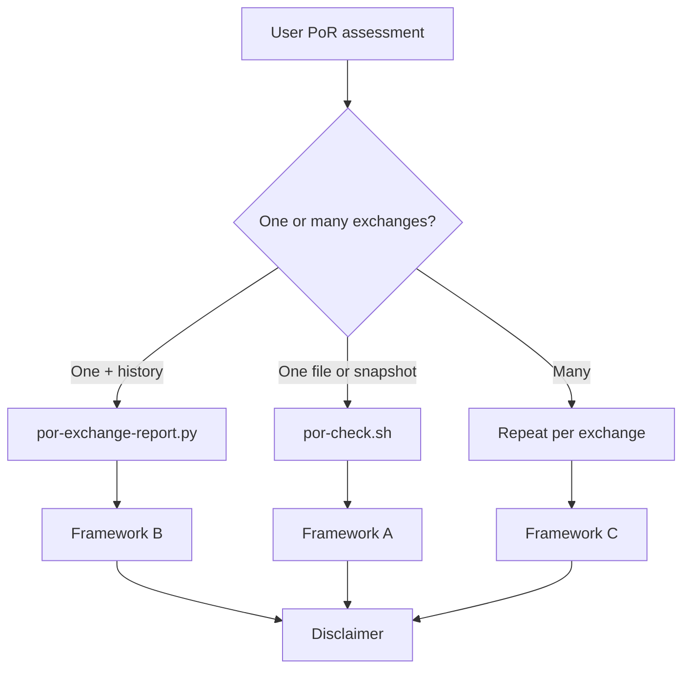

# PoR assessment response framework (agents)

Use this file for **every user-facing PoR evaluation** (one exchange or a batch). Tables only; minimal prose. Always label scores **PoR transparency risk (higher = worse disclosure)** — not reserve adequacy or trade permission. There is no `decision` field; do not invent allow/block/reduce.

Pair with [`presentation-format.md`](presentation-format.md) for cell formatting (`Unavailable`, factor caps).

## Prerequisites (before any answer)

1. Repo root with `git submodule update --init --recursive`.
2. Live reads: `POR_NEAR_CONTRACT=por-digest-v7-index.ardmere-demo-1fc2.testnet` (and `por-exchange-report.py` inherits this default).
3. If `near.live` is not `true`, state that the NEAR block is a **sandbox replay**, not testnet.
4. Cite at least **exchange PoR page**, **Public PoR API** (`officialSources.publicPoRApi`, or **Unavailable**), and one **`publicArtifacts`** URL per exchange.
5. If the user asks **why this matters on NEAR**, for **agents**, or vs **NEAR Intents**, summarize [`SKILL.md`](../SKILL.md) → *Value for NEAR* (solver hedge custodial leg; transparency input only). Do **not** expand that essay into every PoR table reply.

## Route the request

| User intent | Run | Framework |
| --- | --- | --- |
| One assessment file / one snapshot id | `POR_NEAR_CONTRACT=… por-check.sh <path>` | **A** — single snapshot |
| One exchange, latest + optional history | `por-exchange-report.py <exchange> [--months N]` | **B** — exchange window |
| Several exchanges (list, Top N, compare) | `por-exchange-report.py` per exchange (latest row only) or `por-check` on each latest file | **C** — batch |



## Framework A — single snapshot (`por-check.sh`)

Copy structure from [`presentation-format.md`](presentation-format.md) § Single snapshot. Section order:

1. Headline table (`riskScore`, `scoringSource`, stage, effective PoR, `near.matches`, schema).
2. Self-reported reserves (totals + BTC/ETH/USDT/USDC; missing → **Unavailable**).
3. Top factors (≤5 rows, Δ).
4. Verify yourself (`officialSources`).
5. Provenance (contract, `near.live`, manifest/digest alignment).

End with the **Disclaimer** (below).

## Framework B — one exchange (`por-exchange-report.py`)

1. Prefer the script’s default markdown (`--format markdown`).
2. Keep script sections: Latest · Official sources · Self-reported reserves · History.
3. Add **one line** under Latest: **Takeaway** — `{riskScore}/{riskLevel}`, stage, `near.matches`, top factor id (max one phrase).
4. End with **Disclaimer**.

If the user asks only for the latest snapshot, you may omit the history table.

## Framework C — batch (many exchanges)

No batch script yet: run **Framework B** or latest `por-check` per exchange, then assemble **one merged overview table** (headline + self-reported reserves **in the same row**).

### C.1 Batch header

```markdown
## PoR batch · {title}

| Item | Value |
| --- | --- |
| Scope | {comma-separated exchange ids} |
| NEAR contract | `por-digest-v7-index.ardmere-demo-1fc2.testnet` |
| Manifest | `fixtures/digests.json` (`sourceCommit` from file) |
| Metric | **Transparency risk** (higher = worse); not solvency |
| NEAR reads | live testnet unless noted |
```

### C.2 Merged overview (required)

One table. Each row = one exchange’s **latest** snapshot (chain `get_latest` aligned assessment).

| Exchange | Snapshot | Time (UTC) | Stage | Eff. PoR | Risk | Level | NEAR match | Scoring | Liability | Reserve | Total ratio | BTC | ETH | USDT | USDC |
| --- | --- | --- | --- | :---: | ---: | --- | :---: | --- | --- | --- | ---: | ---: | ---: | ---: | ---: |

Column rules:

- **Risk / Level / Scoring / NEAR match**: from `por-check` or exchange report period row for latest id.
- **Eff. PoR**: `yes` / `no`.
- **Reserves**: format USD with `$…`; ratios as `NN.NN%`; any missing self-reported field → **Unavailable** (same as `reserve_display.py`).

### C.3 Official sources (required)

| Exchange | PoR page | Public PoR API | Primary artifact |
| --- | --- | --- | --- |
| {id} | {exchangePorPage} | {publicPoRApi or **Unavailable**} | {first publicArtifacts url or kind+url} |

Do **not** add Public PoR API to the C.2 overview table (keep API under sources).

### C.4 Optional drill-down

- If the user names one exchange from the batch, switch to **Framework B** for that id only.
- Do not attach full history for every row in a batch unless asked.

End with **Disclaimer**.

## Disclaimer (every answer)

> Scores are **ardmere PoR transparency risk** (higher = worse public disclosure), from vendored assessments and optional NEAR digest checks. **Self-reported reserves are exchange-published figures, not verified solvency.** The chain record names assessment bytes; it does not prove reserves.

## Agent checklist

- [ ] Routed to A, B, or C.
- [ ] `POR_NEAR_CONTRACT` = v7-index for live batch/single (or stated sandbox).
- [ ] Batch uses **one merged table** (Framework C.2), not separate headline + reserves tables.
- [ ] Missing reserve fields shown as **Unavailable**.
- [ ] Official PoR page + Public PoR API + artifact cited per exchange.
- [ ] No `decision`; no multi-paragraph methodology unless the user asked.
- [ ] NEAR / Intents value prose only when the user asked (see Prerequisites §5).

## Forbidden

See [`presentation-format.md`](presentation-format.md) § Forbidden.
